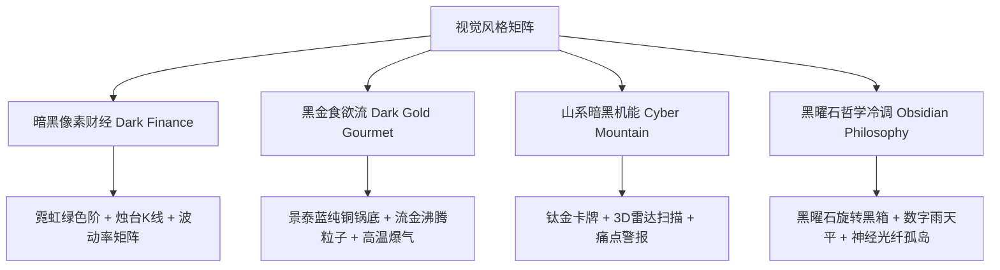

# Pixel & Code-Driven Motion Video Workflow (像素风与代码数学动画视频生产引擎)

[](LICENSE)
[](templates/storyboard-engine/)
[](docs/GROK_CODE_VIDEO_HANDOVER.md)
[](docs/STORYBOARD_TUTORIAL.md)

> **拒绝神经模型抽卡的漂移与算力消耗，用代码逻辑与数学确定性渲染工业级短视频母版。**  
> 本仓库完整沉淀了 **AI 纯代码驱动动画视频（Code-driven Motion Video）** 与 **像素财经/暗黑哲学风格** 的全套架构规范、动效数学模型、故事板分镜母版、实战案例与无头导出管线。

---

## 🌟 核心理念：为什么选择代码动画？

| 维度 | 传统神经扩散视频 (Sora / Kling / Runway) | **代码驱动数学动画 (Code-driven Motion Video)** |
| :--- | :--- | :--- |
| **可控性** | 随机抽卡，文字乱码，前后镜头主体变形漂移 | **100% 绝对数学可控**：每一帧均为时间变量 $t$ 的纯函数 |
| **分辨率与清晰度** | 神经重绘模糊、边缘伪影 | **原生 1080×1920 竖屏超清**，排版如矢量般锋利，质感如 C4D |
| **二次修改成本** | 改一个字需重新耗费几十美金重新抽卡 | **毫秒级重编**：只需修改几行 CSS / JS 参数，一键全片热重载 |
| **综合单片成本** | ¥20 ~ ¥60 / 条，受算力与显卡吞吐严重掣肘 | **≈ ¥0.10 / 条**（接近纯电力与本地无头浏览器渲染成本） |
| **剪辑后处理** | 画面与字幕杂糅，无法拆轨 | **Clean Feed 纯净母版标准**，剪映 Pro 独立文本/音轨精准装配 |

---

## 📐 四大底层非谈判契约 (Non-Negotiable Contracts)

本工作流在编写任何 HTML / Canvas / WebGL 视频母版时，严格遵循四大底线法则：

1. **视频母版纯净度契约 (Clean Feed Rule)**：
   - 严禁在 Canvas 渲染画面底部烧录硬字幕，严禁 `fillText` 污染主画面。
   - 画面底部 20%（$Y \ge 1536$）设置纯净安全区，预留给短视频平台的点赞/评论与剪映独立字幕轨道。
2. **纯数学确定性时间驱动契约 (Deterministic Timing)**：
   - 严禁调用 `Date.now()`、`performance.now()` 或无种子的随机数。
   - 所有粒子轨迹、摄像机推拉、缓动阻尼全部由绝对时间入参 $t$（单位：秒）精确映射。
3. **全自包含与零外部依赖契约 (Zero Asset Dependency)**：
   - 不依赖任何未经打包的第三方外部网络 CDN 或外链图片。
   - 单文件 HTML 即开即走，无跨域限制，保障工业级批处理稳定性。
4. **统一暴露引擎接口契约**：
   ```javascript
   window.DURATION = 60.0;           // 视频总时长（秒）
   window.FPS = 30;                  // 目标渲染帧率
   window.__ready = true;            // 引擎完全初始化就绪标记
   window.renderFrame = function(t); // 核心渲染函数，传入绝对秒数 t 渲染对应帧画面
   ```

---

## 🎨 四大成熟视觉设计风格资产 (Style Tokens)



---

## 📁 仓库工程架构

```bash
pixel-code-video-workflow/
├── docs/                                # 核心知识沉淀与交接指南
│   ├── GROK_CODE_VIDEO_HANDOVER.md      # 423行AI纯代码数学动画视频全流程生产体系规范
│   ├── STORYBOARD_TUTORIAL.md           # 用故事板做Coding视频实战指南（双会话协作SOP）
│   ├── MEMORY_HANDOVER_GREEK_MYTH.md    # 希腊神话重构系列24集记忆交接与金标母版
│   └── MEMORY_HANDOVER_HUNT_SERIES.md   # 猎杀系列商业动效生产沉淀
├── templates/                           # 故事板生产工程母版
│   └── storyboard-engine/               # HyperFrames 故事板脚手架
│       ├── hyperframes.json             # 动效引擎时序配置
│       ├── index.html                   # 全局总装渲染入口
│       ├── tune.html                    # 关键帧微调与走查台
│       ├── timeline.json                # 分镜时序拓扑
│       ├── compositions/                # 镜头组件
│       └── skill/                       # 内置 Agent 协作技能
├── showcases/                           # 实战案例工程（代码与镜头）
│   ├── 01-dark-finance/                 # 暗黑像素财经：钱起源于一种共识
│   ├── 18-boomerang/                    # 回旋镖：时代代价与代际契约（黑曜石哲学）
│   └── 26-greek-sisyphus/               # 古希腊神话：西西弗斯多机位蒙太奇母版
└── scripts/                             # 自动化无头渲染与快照流水线
    ├── render_full.mjs                  # Puppeteer 批量逐帧高保真无头渲染导出
    └── take_snapshots.mjs               # 镜头关键帧自动走查与接触表生成
```

---

## 🚀 快速上手与运行

### 1. 本地实时调试与走查
进入 `templates/storyboard-engine/` 或任意 showcase 案例：
```bash
# 启动本地开发静态服务器
npx serve .
# 打开浏览器访问 http://localhost:3000/tune.html 进行逐帧拖拽微调
```

### 2. 无头高保真离线渲染成片
```bash
# 运行 Puppeteer 无头渲染器导出高质量帧序列并自动合成视频
node scripts/render_full.mjs --input=showcases/18-boomerang/index.html --fps=30
```

### 3. 一键挂载剪映 Pro 独立文本轨
配合配套的 `jianying-draft-export` 技能，一键将代码母版成片、配音与独立双色字幕（香槟金 `#ffd76a`）打包为原生剪映工程，即刻交付商业上线。

---

## 📜 许可证

本项目基于 [MIT](LICENSE) 开源协议，欢迎二次开发、商业视频生产与 Agent 编导赋能！
