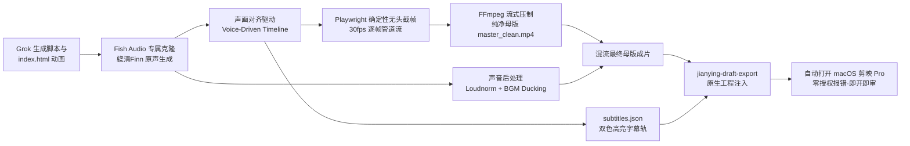

# 【交接指南】AI 纯代码数学动画视频（Code-driven Motion Video）全流程生产体系

> **交接目标**：本指南完整沉淀了当前工作区探索出的“**AI 纯代码数学渲染视频（Code-driven Motion Film）**”全套架构、数学图形学引擎规范、视觉审美系统与下游自动化工程闭环。
> 供 **Grok**（以及后续大模型协作伙伴）作为**创意程序员（Creative Coder）与影视动画导演**，直接对齐全部标准、即刻接单并独立生成工业级确定性母版代码！

---

## 目录
1. [宏观认知：为什么采用纯代码数学动画？](#1-宏观认知为什么采用纯代码数学动画)
2. [工作区已沉淀案例复盘（Memory 全景）](#2-工作区已沉淀案例复盘memory-全景)
3. [四大底层非谈判契约（Non-Negotiable Contracts）](#3-四大底层非谈判契约non-negotiable-contracts)
4. [确定性 Canvas 2D 动效引擎核心架构规范](#4-确定性-canvas-2d-动效引擎核心架构规范)
5. [数学图形学与质感黑魔法（Grok 编码工具包）](#5-数学图形学与质感黑魔法grok-编码工具包)
6. [四大成熟视觉风格资产色卡（Style Tokens）](#6-四大成熟视觉风格资产色卡style-tokens)
7. [视频导演级 Prompt 提示词工业化模板](#7-视频导演级-prompt-提示词工业化模板)
8. [下游自动化工程流水线（无头渲染 + 配音 + 剪映直出）](#8-下游自动化工程流水线无头渲染--配音--剪映直出)
9. [实战测试题：Grok 首次出片任务参考](#9-实战测试题grok-首次出片任务参考)

---

## 1. 宏观认知：为什么采用纯代码数学动画？

传统的 AI 视频（如 Sora / Runway / Kling / 海螺）本质是**扩散模型神经生成**，存在致命硬伤：
- ❌ **文字与数据乱码**：无法稳定展示真实排版、数据指标、百分比与图表；
- ❌ **时空连续性漂移**：前后镜头主体容易形变、闪烁、不受物理法则约束；
- ❌ **不可二次修改**：镜头穿帮必须全部抽卡重摇，算力消耗极高且不可控。

而我们建立的 **代码驱动动画（Code-driven Motion Film）**：
- ✅ **100% 确定性与数学可控**：每一帧均是时间变量 $t$ 的纯函数，镜头移动、物理粒子、阻尼缓动毫秒级精确；
- ✅ **无限分辨率与零失真**：1080×1920 竖屏超清渲染，文字排版极其锋利，图形如 C4D 般质感；
- ✅ **一键微调**：想改一个文字、调慢 0.5 秒镜头或改色板，只需修改几行代码变量；
- ✅ **与专业剪辑软件无缝桥接**：母版保持纯净留白，字幕与音轨在剪映 Pro 中独立分层，随时换肤。

---

## 2. 工作区已沉淀案例复盘（Memory 全景）

我们在本地 `/Users/mlx/Desktop/IP/code-video-works/` 已完成 18 个项目，其中具有里程碑意义的三大代表作：

| 案例名称 | 时长规格 | 视觉风格 | 核心叙事与视觉隐喻 | 交付产物 |
| :--- | :--- | :--- | :--- | :--- |
| **《马家铜瓢火锅 · 黑金食欲流》** | 18s @ 30fps (540帧) | 黑金食欲流 (Dark Gold Gourmet) | 景泰蓝纯铜锅底、流金沸腾粒子、高温爆气、立盘不倒 3D 托盘翻转、8s 极速熟肉光圈 | `14-majia-kinetic-v1` 成片 + 剪映工程 |
| **《杉门鸟户外集合店 · 痛点撕开篇》** | 28s @ 30fps (840帧) | 山系暗黑机能风 (Cyber Mountain) | 传统服装店压货纸箱压顶、红色打叉警报、吊牌 6 折钛金卡牌、3D 雷达 8km 结界扫描 | `17-shanmenniao-pain-v1` 成片 + 剪映工程 |
| **《回旋镖 · 时代代价与代际契约》** | 60s @ 30fps (1800帧) | 黑曜石哲学冷调 (Obsidian Philosophy) | 旋转黑曜石决策黑箱、1986→2026 年份飞旋、1752万数字雨与天平倾斜、观念齿轮脱轨碎镜、AI神经光纤与男女孤岛擦肩、养老金链条卡死 | `18-boomerang-v1` 成片 + 剪映工程 |

---

## 3. 四大底层非谈判契约（Non-Negotiable Contracts）

在编写 HTML/JS 代码时，Grok 必须**百分之百遵守以下 4 条底线法则**：

### 契约一：视频母版纯净度规范 (Clean Feed Rule)
- ❌ **绝对严禁在 Canvas 渲染画面底部压制/硬烧录任何口播字幕**！
- ✅ **底部安全区（Safe Zone）保留**：
  - 画布规格为 $1080 \times 1920$。
  - **$Y > 1536$（画面底部约 20% 区域）必须通过 `cleanFeed()` 函数渲染纯净暗金或黑灰渐变**，严禁放置主视觉元素、核心图表或小字。
  - 口播字幕必须交由剪映 Pro 的独立文本轨道管理，确保母版素材干净纯粹、粒子不被遮挡。

### 契约二：纯数学确定性时间驱动协议 (Deterministic Timing)
- ❌ **绝对严禁使用任何系统时钟或非受控随机**：
  - 严禁 `Date.now()`、`performance.now()`；
  - 严禁在渲染循环中直接调用未经种子的 `Math.random()`（否则帧与帧之间会抖动闪烁）；
- ✅ **纯时间驱动入参**：
  - 画面所有元素的位置、透明度、旋转角、粒子位置必须是绝对时间入参 $t$（以秒为单位的浮点数，如 `t = 2.45`）的数学确定性映射；
  - 伪随机必须采用基于确定性哈希函数（如 `hash(n)` 或正弦波叠加）生成。

### 契约三：全自包含与零外部依赖 (Zero Asset Dependency)
- ❌ **绝对严禁引入外部图片、贴图或未经打包的外部 CDN 脚本**！
- ✅ 所有几何构图、3D 空间投影视角、机械齿轮、折线图表、金属光泽、玻璃碎裂、AI 神经元等，**全部由原生 HTML5 Canvas 2D API 数学算法实时逐点绘制**。单文件 HTML 即开即走，无任何跨域或网络中断风险。

### 总结暴漏接口契约：
每个 HTML 母版必须在全局 `window` 暴露以下关键变量与函数：
```javascript
window.DURATION = 60.0;          // 视频总时长（秒）
window.FPS = 30;                 // 帧率
window.__ready = true;           // 引擎完全初始化完成标记
window.renderFrame = function(t) { ... }; // 核心渲染函数，传入任意秒数 t 即可画出该时间点的绝对画面
```

---

## 4. 确定性 Canvas 2D 动效引擎核心架构规范

Grok 在生成 HTML 母版时，可严格遵循以下骨架规范：

```html
<!DOCTYPE html>
<html lang="zh-CN">
<head>
<meta charset="UTF-8">
<title>Video Master Engine</title>
<style>
  html, body { margin: 0; padding: 0; background: #000; height: 100%; overflow: hidden; }
  #stage { display: block; height: 100vh; width: calc(100vh * 9 / 16); margin: 0 auto; background: #000; }
</style>
</head>
<body>
<canvas id="stage" width="1080" height="1920"></canvas>
<script>
(function() {
  'use strict';
  const W = 1080, H = 1920, FPS = 30, DURATION = 60.0, SAFE_Y = 1536;
  window.DURATION = DURATION;
  window.FPS = FPS;

  const cv = document.getElementById('stage');
  cv.width = W; cv.height = H;
  const ctx = cv.getContext('2d');

  /* ---------- 数学与缓动工具库 ---------- */
  const clamp = (x, a = 0, b = 1) => (x < a ? a : x > b ? b : x);
  const lerp = (a, b, k) => a + (b - a) * k;
  const seg = (t, a, b) => clamp((t - a) / (b - a));
  const ss = (x) => { x = clamp(x); return x * x * (3 - 2 * x); }; // smoothstep
  const easeOutCubic = (x) => 1 - Math.pow(1 - clamp(x), 3);
  const hash = (n) => { const s = Math.sin(n * 127.1 + 311.7) * 43758.5453; return s - Math.floor(s); };

  /* ---------- Clean Feed 底部安全区遮罩 ---------- */
  function cleanFeed() {
    ctx.save();
    ctx.globalAlpha = 1;
    ctx.shadowBlur = 0;
    ctx.globalCompositeOperation = 'source-over';
    // 1500 -> 1536 平滑过渡
    const f = ctx.createLinearGradient(0, 1500, 0, SAFE_Y);
    f.addColorStop(0, 'rgba(5,5,6,0)');
    f.addColorStop(1, 'rgba(5,5,6,1)');
    ctx.fillStyle = f;
    ctx.fillRect(0, 1500, W, SAFE_Y - 1500);
    // 1536 -> 1920 纯净暗金渐变，供剪映独立字幕排版
    const g = ctx.createLinearGradient(0, SAFE_Y, 0, H);
    g.addColorStop(0, '#050506');
    g.addColorStop(1, '#0e0b07');
    ctx.fillStyle = g;
    ctx.fillRect(0, SAFE_Y, W, H - SAFE_Y);
    ctx.restore();
  }

  /* ---------- 主渲染函数 ---------- */
  function renderFrame(t) {
    t = clamp(+t || 0, 0, DURATION);
    ctx.setTransform(1, 0, 0, 1, 0, 0);
    ctx.globalAlpha = 1;
    ctx.clearRect(0, 0, W, H);

    // 1. 背景绘制 (动态星云/暗黑网格/流光)
    // 2. 摄像机抖动与缩放变换 (Camera Tracking)
    // 3. 分幕渲染 (根据 t 激活对应幕次并交叉渐变)
    // 4. 关键 HUD 信息层（标题、关键词、印章、光斑）
    // 5. 胶片暗角与微噪点
    // 6. 执行母版纯净度安全区清理
    cleanFeed();
  }

  window.renderFrame = renderFrame;
  renderFrame(0);
  window.__ready = true;

  // 预览循环：常规浏览器直接播放；在无头渲染模式（带 ?capture=1）时静默不启动
  const params = new URLSearchParams(location.search);
  if (!navigator.webdriver && !params.has('capture')) {
    let t0 = performance.now();
    const loop = (now) => {
      renderFrame(((now - t0) / 1000) % DURATION);
      requestAnimationFrame(loop);
    };
    requestAnimationFrame(loop);
  }
})();
</script>
</body>
</html>
```

---

## 5. 数学图形学与质感黑魔法（Grok 编码工具包）

要做出“惊艳如 C4D/动效设计师打磨”的画面，Grok 需熟练运用以下数学图形技巧：

### 1. 拟 3D 旋转与透视投影（3D Projection Matrix）
无需载入庞大 3D 库，几行纯数学即可实现空间旋转物体（如立方体、翻转卡牌、回旋镖）：
```javascript
// 三轴欧拉角旋转
function rot(p, ax, ay, az) {
  let [x, y, z] = p;
  let c = Math.cos(ax), s = Math.sin(ax), t = y * c - z * s; z = y * s + z * c; y = t;
  c = Math.cos(ay); s = Math.sin(ay); t = x * c + z * s; z = -x * s + z * c; x = t;
  c = Math.cos(az); s = Math.sin(az); t = x * c - y * s; y = x * s + y * c; x = t;
  return [x, y, z];
}

// 针孔透视相机投影 (cx, cy 为视口中心，f 为焦距)
function proj(p, cx, cy, f = 1400) {
  const z = Math.max(p[2], -f + 50);
  const scale = f / (f + z);
  return [cx + p[0] * scale, cy + p[1] * scale, scale, z];
}
```

### 2. 电影级发光辉光与多层泛光（Glow & Bloom）
在 Canvas 2D 中模拟光学泛光：
```javascript
// 第一层：核心高亮亮线
ctx.shadowColor = 'rgba(255, 215, 120, 0.9)';
ctx.shadowBlur = 12;
ctx.strokeStyle = '#fff8e7';
ctx.stroke();

// 第二层：大范围环境氛围辉光
ctx.shadowColor = 'rgba(232, 195, 116, 0.4)';
ctx.shadowBlur = 45;
ctx.stroke();
```

### 3. 摄像机微晃动与重击卡点（Camera Trajectory & Hit Shake）
在特定重击瞬间（如印章落下、齿轮咬死、数字撞屏），通过阻尼正弦衰减创造物理冲击力：
```javascript
function cameraShake(t, hitTime, intensity = 25) {
  const dt = t - hitTime;
  if (dt < 0 || dt > 0.45) return { x: 0, y: 0 };
  const decay = Math.exp(-dt * 12);
  const sx = Math.sin(dt * 80) * intensity * decay;
  const sy = Math.cos(dt * 90) * intensity * decay * 0.7;
  return { x: sx, y: sy };
}
```

### 4. 胶片噪点与微质感（Film Grain）
```javascript
function grain(t) {
  ctx.save();
  ctx.globalAlpha = 0.045;
  ctx.fillStyle = '#fff';
  for (let i = 0; i < 400; i++) {
    const rx = hash(i * 13.7 + t * 43.1) * W;
    const ry = hash(i * 29.3 + t * 67.5) * SAFE_Y;
    ctx.fillRect(rx, ry, 1.5, 1.5);
  }
  ctx.restore();
}
```

---

## 6. 四大成熟视觉风格资产色卡（Style Tokens）

Grok 在导演不同题材视频时，直接选用以下预设视觉规范：

### 风格 A：黑金食欲流 (Dark Gold Gourmet) — 适用于高端餐饮、爆品推介
- **底色**：深邃景泰蓝与暗曜石玄黑 `[8, 12, 18]`
- **主调金**：汉宫金流 `[235, 195, 115]`、琥珀暖黄 `[255, 160, 45]`
- **微动效**：80℃ 汤底沸腾粒子升腾、3D 景泰蓝立盘翻转不倒、微距光圈高光扫掠。

### 风格 B：山系暗黑机能风 (Cyber Mountain) — 适用于 B 端连锁招商、痛点反差
- **底色**：冷冽钛灰 `[14, 16, 20]`、深渊炭黑 `[5, 6, 8]`
- **高反差警示**：警报正红 `[255, 65, 54]`（用于传统死穴）、科技荧光绿 `[46, 204, 113]`（用于品牌底牌）
- **微动效**：库房纸箱压顶下坠、发光钛金卡牌 3D 翻面展开、3D 独家保护雷达波扩散。

### 风格 C：黑曜石哲学冷调 (Obsidian Philosophy) — 适用于硬核深度知识、社会学
- **底色**：黑曜石虚空 `[3, 4, 7]`、冷黑渐变 `[10, 12, 16]`
- **哲思色彩**：时光金 `[232, 195, 116]`、赛博数码青蓝 `[56, 230, 255]`
- **微动效**：四十年时光光锥飞旋、巨型失衡天平下坠砸盘、脱轨齿轮火花与破裂镜像、AI光纤相向漂移错开。

### 风格 D：赛博数据与逻辑咬合流 (Cyber Data & Logic) — 适用于 AI 工具、GEO算法
- **底色**：星际深空蓝黑 `[6, 10, 22]`
- **数据辉光**：量子青蓝 `[0, 240, 255]`、矩阵紫 `[180, 70, 255]`
- **微动效**：数据瀑布流、拓扑网络节点脉冲咬合、算力流向光斑流。

---

## 7. 视频导演级 Prompt 提示词工业化模板

当向 Grok 下达视频制作任务时，必须提供**六大导演要素**（避免只有一句话让 AI 凭空猜测）：

```markdown
# 任务：制作一条【XX 秒】电影级纯代码动画母版大片《项目名》

## 1. 题材定位与商业诉求
- 目标人群与平台：抖音 / B站 / 视频号
- 核心情绪价值：[如：震撼警醒 / 痛点暴击 / 食欲全开]
- 节奏调性：[如：120 BPM 激昂快节奏 / 60 BPM 克制史诗感]

## 2. 视觉美学规范 (Style Tokens)
- 选定风格：[黑金食欲流 / 山系暗黑机能 / 黑曜石哲学冷调 / 赛博数据]
- 主题色板：基底 RGB、主光色 RGB、警示色 RGB

## 3. 分幕时间轴与卡点对照表 (Timeline Cue Sheet)
- 幕次划分（精确到秒，如 0~5s, 5~12s...）
- 每一幕的口播文案（每幕约 5 字/秒）
- 每一幕的核心高亮关键词（Highlight Word）
- 核心卡点瞬间与视觉隐喻（如：3.5s 天平砸落震屏、8.0s 白闪切换）

## 4. 技术强制协议
- 规格：1080 × 1920（竖屏 9:16），30 FPS，总时长精确为 XX.0 秒；
- 暴露 `window.renderFrame(t)`，`window.DURATION`，`window.__ready = true`；
- 严禁外部图片依赖，纯数学实时计算；
- 严格执行 Clean Feed Rule：Y > 1536 区域留白给字幕，禁止绘制硬字幕。

请直接输出包含完整 CSS/Canvas 单文件可运行的 ```html ... ``` 代码！
```

---

## 8. 下游自动化工程流水线（Fish Audio 原声克隆 + 无头渲染 + 剪映直出）

当 Grok 产出分镜脚本与 `index.html` 动画骨架后，本地自动化工具链通过以下流水线完成成片与工程发布：



### 1. 配音生成引擎：Fish Audio 专属克隆技术规范
所有口播音频均由 **Fish Audio 专属声音克隆 API** 驱动，参数与配置锁定如下：
- **API 端点**：`https://api.fish.audio/v1/tts`
- **专属 Voice ID**：`db0639bd49fd407e9845829ee044cfa4`（骁清Finn 原声克隆）
- **推荐模型**：`s2.1-pro-free`
- **采样率与格式**：`format: mp3`，44.1kHz（最终母带混音时统一升采样至 48kHz）
- **生成超参数**：
  - `temperature: 0.6`（过高易破音，过低发音单调，0.6 为最佳自然度）
  - `top_p: 0.72`
  - `repetition_penalty: 1.2`
  - `condition_on_previous_chunks: true`

```python
import json, urllib.request
from pathlib import Path

API_KEY = "sk-fish-4GPT3tSw1c0YN-rxK0jZiHDbpcAHIAAZlndZSbPyEB4"
VOICE_ID = "db0639bd49fd407e9845829ee044cfa4"

def synthesize_line(text: str, output_path: Path):
    payload = {
        "text": text,
        "reference_id": VOICE_ID,
        "temperature": 0.6,
        "top_p": 0.72,
        "repetition_penalty": 1.2,
        "format": "mp3"
    }
    req = urllib.request.Request(
        "https://api.fish.audio/v1/tts",
        data=json.dumps(payload).encode("utf-8"),
        headers={
            "Authorization": f"Bearer {API_KEY}",
            "Content-Type": "application/json",
            "model": "s2.1-pro-free"
        },
        method="POST"
    )
    with urllib.request.urlopen(req, timeout=30) as resp:
        output_path.write_bytes(resp.read())
```

### 2. 声画对齐与混音算法（Voice-Driven Timeline & Mastering Pipeline）
- **核心原则**：以人声口播的真实物理时长为骨架，反向驱动视频画面的剪辑与变速，严禁无意义的画面硬凑！
- **响度标准化 (Loudness Normalization)**：
  使用 `loudnorm=I=-16:TP=-1.5:LRA=11`，保证不同句子拼接时音量绝对一致，不爆音、不忽大忽小；
- **背景音乐动态闪避 (BGM Ducking & Mixing)**：
  - 人声音轨音量保持 1.0；
  - 背景音乐（BGM）压低至 `volume=0.14 ~ 0.16`，保证人声清脆突出；
  - BGM 片头 1 秒平滑淡入（`afade=t=in:d=1`），片尾 3~4 秒平滑淡出（`afade=t=out:st=...:d=4`）。

### 3. 流式渲染脚本范式 (`render.mjs`)
通过 Playwright 控制 Chrome 无头截帧，经管道直接输入 FFmpeg，避免磁盘写入数千张图片碎片：
```javascript
import { chromium } from "playwright";
import { spawn } from "node:child_process";

const browser = await chromium.launch({ headless: true });
const page = await browser.newPage({ viewport: { width: 1080, height: 1920 } });
await page.goto("file:///path/to/index.html?capture=1");
await page.waitForFunction(() => window.__ready === true);

const ffmpeg = spawn(FFMPEG, [
  "-y", "-f", "image2pipe", "-vcodec", "mjpeg", "-r", "30", "-i", "-",
  "-c:v", "libx264", "-pix_fmt", "yuv420p", "-crf", "16", "master_clean.mp4"
], { stdio: ["pipe", "inherit", "inherit"] });

const totalFrames = Math.round(DURATION * 30);
for (let i = 0; i < totalFrames; i++) {
  await page.evaluate(t => window.renderFrame(t), i / 30);
  const buf = await page.screenshot({ type: "jpeg", quality: 96 });
  ffmpeg.stdin.write(buf);
}
ffmpeg.stdin.end();
```

### 4. 剪映 Pro 原生工程自包含直出 (`export_draft.py`)
直接调用我们的 `jianying-draft-export` 核心库，自动将母版 MP4、封面、以及带描边和金色高亮的独立文本轨道部署入 `~/Movies/JianyingPro/User Data/Projects/com.lveditor.draft/`，并拉起剪映 Pro 自动打开。

---

## 9. 实战测试题：Grok 首次出片任务参考

若让 Grok 进行首次出片测试，建议直接布置以下实战任务：

> **实战命题**：《智能跃迁：从算力狂飙到智能降维》（30秒 科技哲学大片）  
> - **规格**：1080 × 1920，30 FPS，900 帧。
> - **风格**：赛博数据与黑曜石冷调混合。
> - **分幕**：
>   - 0~8s 【算力狂飙】：数千个服务器矩阵发光立方体向外无序爆炸扩充，金色算力指数折线陡峭垂直冲天；
>   - 8~18s 【物理撞墙】：暗红能量墙封死，算力粒子撞击崩裂，能耗与热量警示标牌砸落震屏；
>   - 18~25s 【降维突围】：核心深处凝结成一颗微型微光量子芯片，贝塞尔光纤向四周展开优雅几何网络；
>   - 25~30s 【终局闭环】：芯片定格中央发光，环形圆环闭合，打出终章“不是算力变大，而是模型变聪明”。
> - **底线要求**：严格执行 Clean Feed Rule，Y > 1536 留白给字幕。

---

**文档归档路径**：
- 智能体 Artifact 目录：`file:///Users/mlx/.gemini/antigravity/brain/0ad04ff7-f375-4ae3-843d-c7ec776c8420/GROK_CODE_VIDEO_HANDOVER.md`
- 本地工作目录：`/Users/mlx/Desktop/IP/code-video-works/GROK_CODE_VIDEO_HANDOVER.md`
