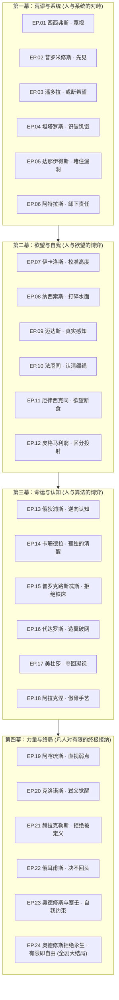

# 《古希腊神话史诗重构》全 24 集电影级竖屏视频工程架构大纲

> **创作者 IP**：骁清Finn  
> **核心定位**：高维思想重构短视频史诗，加缪荒谬哲学 + 现代人生存困境 + 认知觉醒武器库  
> **视听标准**：竖屏 9:16（1080×1920），30 FPS，55.0 秒确定性 Canvas 物理粒子 + Bana/Flow 电影级视觉底板  
> **合规红线**：母版纯净度铁律（Clean Feed Rule，底端 20% $Y > 1536$ 纯净无字幕）；剪映独立字幕轨道，香槟金高光（`#ffd76a`）+ 黑色描边  
> **核心母题**：**诸神是系统，凡人的唯一武器是清醒。**

---

## 全剧四大幕与 24 件“心理武器”矩阵

---

## 24 集核心命题对照表

| 集数 | 人物 / 篇名 | 神话反常识核心 | 现代生存痛点映射 | 交付的心理武器 | 互动 CTA 提问 |
| :---: | :--- | :--- | :--- | :---: | :--- |
| **01** | **西西弗斯** | 锁住死神从冥府逃回，只因太想活着 | 绩效清零、房贷续期、周一重启 | **蔑视** | 你的石头，叫什么名字？ |
| **02** | **普罗米修斯** | 名字本义“先见”，早知刑罚却依然盗火 | 吹哨人先被优化，看客冷漠烤火 | **先见** | 你选择看见，还是继续烤火？ |
| **03** | **潘多拉** | 原典是陶罐非魔盒，希望是宙斯的画饼 | 明年调薪、上市就自由的内耗等待 | **戒断希望** | 你吃过最大的饼是什么？ |
| **04** | **坦塔罗斯** | 齐颈流水低头即退，果实伸手即弹开 | 消费主义与仓鼠轮，永远差一寸 | **识破饥饿** | 哪样东西是你买到后觉得最空虚的？ |
| **05** | **达那伊得斯** | 五十姐妹用无底漏瓮在冥府舀水注池 | 信息流刷屏、无休止输入却精神极度匮乏 | **堵住漏洞** | 你每天花几个小时往“漏瓮”里灌水？ |
| **06** | **阿特拉斯** | 珀尔修斯用美杜莎头颅石化他才得解脱 | 东亚懂事长子、家庭顶梁柱无限责任 | **卸下** | 如果你松手，天真的会塌吗？ |
| **07** | **伊卡洛斯** | 父亲不仅警告别飞太高，更警告“别飞太低” | 平庸的海水浸湿羽毛，也是一种沉沦 | **校准高度** | 你更怕被太阳灼伤，还是被海水泡烂？ |
| **08** | **纳西索斯** | 迷恋的不是自己，是自己完美的水面倒影 | 社交滤镜、信息茧房、算法迎合的虚假自恋 | **打碎水面** | 离开美颜和点赞，你敢看真实的自己吗？ |
| **09** | **迈达斯** | 点石成金后连食物和女儿都变成冰冷黄金 | 丧失全部感知力与温度的虚假“财务自由” | **真实感知** | 如果财富让你丧失感知，你还要吗？ |
| **10** | **法厄同** | 强驾太阳神车烧焦大地，最终被雷劈死 | 德不配位、资源错配与盲目膨胀的下场 | **认清缰绳** | 你手里握着的，到底是谁的缰绳？ |
| **11** | **厄律西克同** | 得罪德墨忒尔被罚永饥，最后吃掉自己的肉 | 报复性熬夜、情绪暴食、欲望吞噬健康 | **欲望断食** | 你的欲望，是不是正在啃食你的身体？ |
| **12** | **皮格马利翁** | 爱上亲手雕刻的象牙少女像 | AI 伴侣、虚拟投射与回避真实人类亲密 | **区分投射** | 你爱的是屏幕里的人，还是自己的投射？ |
| **13** | **俄狄浦斯** | 答出斯芬克斯之谜，却掉进自己逃离的预言 | 推荐算法与自我实现的标签牢笼 | **逆向认知** | 算命与算法，到底是谁在塑造你？ |
| **14** | **卡珊德拉** | 阿波罗诅咒她看清所有预言却无人相信 | 敏锐者的孤独、直言不讳却被孤立的先知 | **孤独的清醒** | 说出没人信的真相，你后悔过吗？ |
| **15** | **普罗克路斯忒斯** | 铁床铁律：个子长的截肢，个子短的拉伸 | 标准化考评、削足适履的教育与KPI流水线 | **拒绝铁床** | 你为了适应别人的标准，切掉了什么？ |
| **16** | **代达罗斯** | 迷宫的设计者，最终把自己锁进了迷宫 | 程序员写出裁掉自己的算法，制度建造者被困 | **造翼破网** | 你亲手建起的舒适圈，是不是你的牢笼？ |
| **17** | **美杜莎** | 被波塞冬侵犯、被雅典娜诅咒，反成妖孽 | 完美受害者污名化、猎巫与被强加的凝视 | **夺回凝视** | 谁在用世俗的目光，把你定义成怪物？ |
| **18** | **阿拉克涅** | 织锦揭露诸神荒淫，被雅典娜变成蜘蛛 | 民间手艺人硬刚权威、傲骨才华的不屈 | **傲骨手艺** | 面对权力，你敢亮出自己的手艺吗？ |
| **19** | **阿喀琉斯** | 唯一的死穴，恰恰是母亲爱他握住的脚后跟 | 战无不胜的强者盲区，爱是铠甲也是软肋 | **直视弱点** | 你藏得最深的软肋，叫什么？ |
| **20** | **克洛诺斯** | 害怕被夺权而吞噬自己的亲生骨肉 | 职场老人政治、代际压制与吞噬年轻人的系统 | **弑父觉醒** | 压制你成长的“长辈”，你敢超越吗？ |
| **21** | **赫拉克勒斯** | 终其一生在完成赫拉强加的“十二项劳役” | 被社会时钟、家庭期待设定的NPC通关人生 | **拒绝被定义** | 这十二项指标，真是你想打的怪吗？ |
| **22** | **俄耳甫斯** | 地狱门口致命回头，欧律狄刻化作青烟 | 关键抉择时刻的不信任、过度患得患失 | **决不回头** | 那次致命的回头，你失去了什么？ |
| **23** | **塞壬之歌** | 奥德修斯把自己绑在桅杆上听歌却不受诱惑 | 诱惑过载时代的信息禁食与极端自控策略 | **自我约束** | 面对致命诱惑，你愿意把自己绑在什么上面？ |
| **24** | **奥德修斯拒绝永生** | 拒绝女神卡吕普索的永生诱惑，选择回家死去 | 终章呼应EP.01：接纳生老病死与人生的有限性 | **有限即自由** | 如果给你无聊的永生，你愿意换现在的人间吗？ |

---

## 全剧 24 集工程脚本与生产手册索引

- [全剧工业化生产管线与视觉垫片总览手册](file:///Users/mlx/Desktop/IP/code-video-works/26-greek-sisyphus/series_scripts/PRODUCTION_MANUAL.md) (Master Production Manual)
- [第一幕前篇（EP.01 ~ EP.03）](file:///Users/mlx/Desktop/IP/code-video-works/26-greek-sisyphus/series_scripts/EP01_to_EP03.md)：西西弗斯 · 普罗米修斯 · 潘多拉
- [第一幕后篇（EP.04 ~ EP.06）](file:///Users/mlx/Desktop/IP/code-video-works/26-greek-sisyphus/series_scripts/EP04_to_EP06.md)：坦塔罗斯 · 达那伊得斯 · 阿特拉斯
- [第二幕前篇（EP.07 ~ EP.09）](file:///Users/mlx/Desktop/IP/code-video-works/26-greek-sisyphus/series_scripts/EP07_to_EP09.md)：伊卡洛斯 · 纳西索斯 · 迈达斯
- [第二幕后篇（EP.10 ~ EP.12）](file:///Users/mlx/Desktop/IP/code-video-works/26-greek-sisyphus/series_scripts/EP10_to_EP12.md)：法厄同 · 厄律西克同 · 皮格马利翁
- [第三幕前篇（EP.13 ~ EP.15）](file:///Users/mlx/Desktop/IP/code-video-works/26-greek-sisyphus/series_scripts/EP13_to_EP15.md)：俄狄浦斯 · 卡珊德拉 · 普罗克路斯忒斯
- [第三幕后篇（EP.16 ~ EP.18）](file:///Users/mlx/Desktop/IP/code-video-works/26-greek-sisyphus/series_scripts/EP16_to_EP18.md)：代达罗斯 · 美杜莎 · 阿拉克涅
- [第四幕前篇（EP.19 ~ EP.21）](file:///Users/mlx/Desktop/IP/code-video-works/26-greek-sisyphus/series_scripts/EP19_to_EP21.md)：阿喀琉斯 · 克洛诺斯 · 赫拉克勒斯
- [第四幕后篇（EP.22 ~ EP.24）](file:///Users/mlx/Desktop/IP/code-video-works/26-greek-sisyphus/series_scripts/EP22_to_EP24.md)：俄耳甫斯 · 塞壬 · 奥德修斯拒绝永生（全剧大结局）

